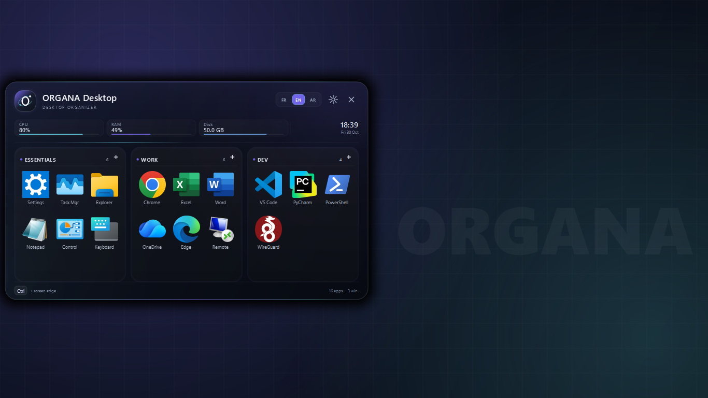
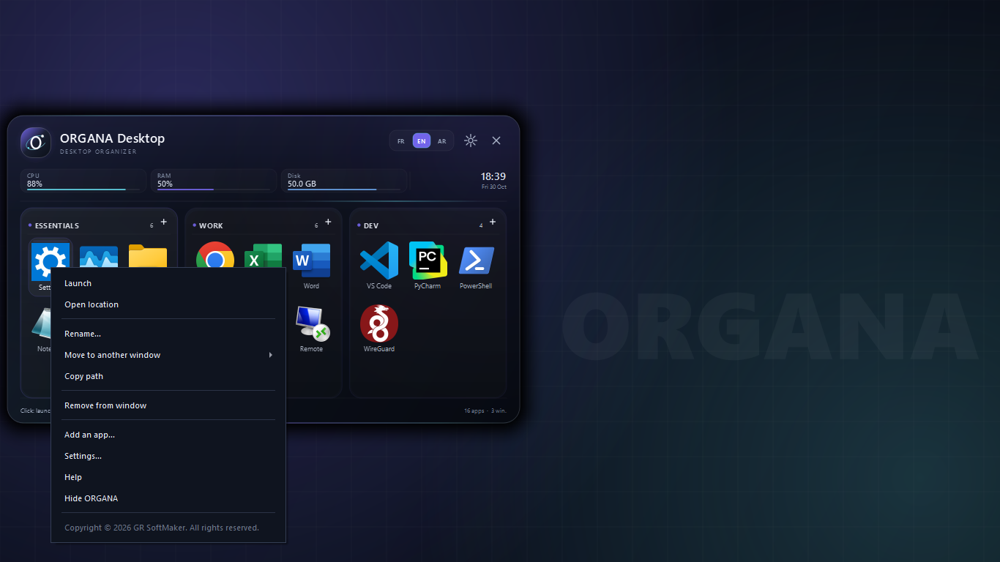
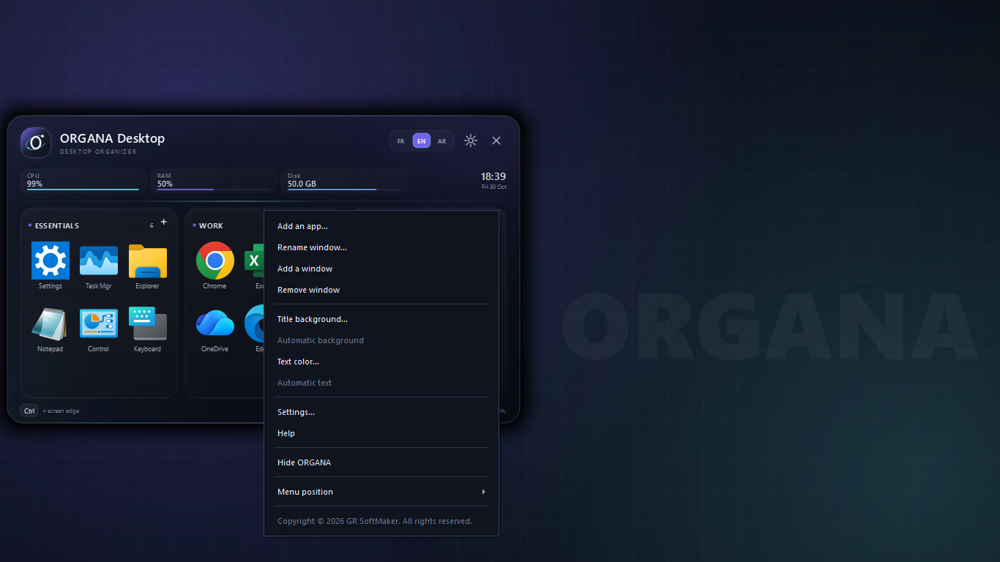
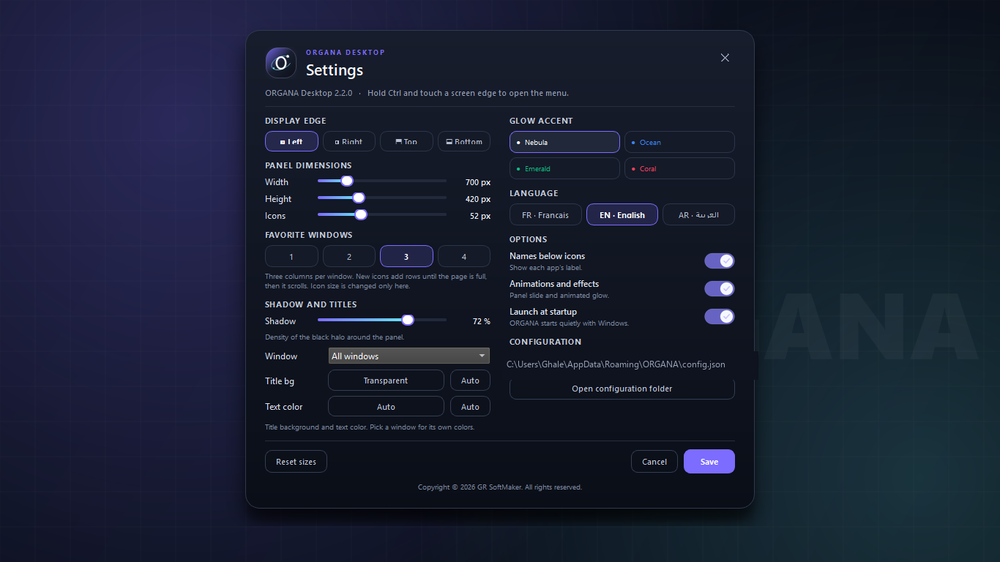
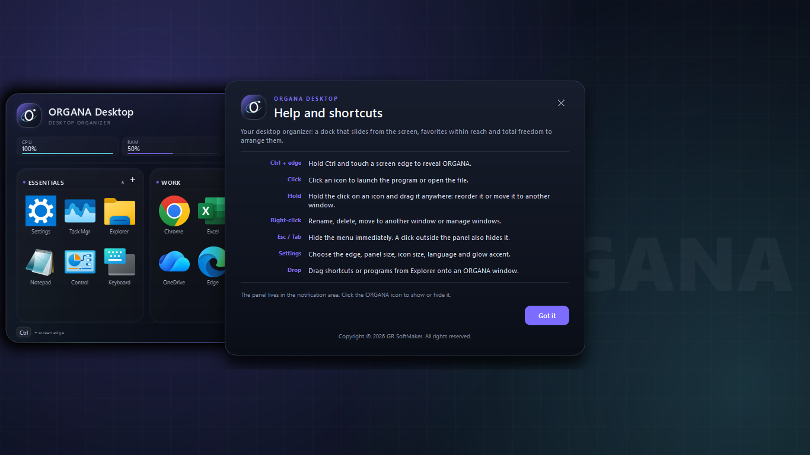

<div align="center">

# ORGANA Desktop

**A native Windows dock for everything you launch.**
Hold `Ctrl`, touch a screen edge, and your applications slide out — organized, labeled and one click away.


[**Download ORGANA.exe**](../../releases/latest) · [How it works](#how-it-works) · [Settings](#settings-reference) · [Troubleshooting](#troubleshooting)

</div>



---

## What ORGANA is

ORGANA is a **desktop organizer** for Windows. Instead of hunting through the Start menu, the desktop or an overflowing taskbar, you keep your everyday programs, folders, scripts and shortcuts in a dock that lives **outside the screen**, and appears only when you ask for it.

- **No permanent window.** The panel waits off-screen; nothing is stolen from your desktop.
- **One gesture.** Hold `Ctrl` and push the pointer against a screen edge.
- **Organized.** Up to four side-by-side windows, each with its own name and colors.
- **Native.** Drawn pixel by pixel with Qt's painter — no embedded browser, no Electron, no web runtime.
- **Portable.** A single 36 MB executable. No installer, no service, no driver.

## Why another launcher

| The usual problem | ORGANA's answer |
|---|---|
| Desktop icons buried under windows | A panel that floats above everything, on demand |
| Taskbar buttons too small to read | 26–112 px icons with real labels |
| Launching tools means 4 clicks | `Ctrl` + edge, then one click |
| Launchers that eat 300 MB of RAM | ~36 MB on disk, idle CPU at 0 %, no background polling of the file system |
| Tools that need admin rights | Runs as a normal user, no hook, no driver |

---

## Screenshots

### Favorites windows

The panel opens with as many as **four windows side by side**, each a 3-column grid. Window titles are editable, and every window can carry its own title background and text color.


### Item menu

Right-click any icon: launch, reveal the file location, rename it, move it to another window, copy its path, or remove it.



### Window menu

Right-click a window's empty area to add an app, add a window, restyle the title bar, or open the settings.



### Settings



### Help and shortcuts



---

## Quick start

1. **Download** `ORGANA.exe` from the [latest release](../../releases/latest).
2. **Run it.** The panel appears once, then retreats to the notification area.
3. **Hold `Ctrl`** and move the pointer to the edge of the screen you chose (left by default).
4. **Click an icon** to launch it. `Esc`, `Tab` or a click outside closes the panel.

> **Windows SmartScreen:** the executable is not code-signed, so the first launch may show *"Windows protected your PC"*. Choose **More info → Run anyway**. Some antivirus engines also flag unsigned PyInstaller binaries as *"unknown"*; the file is a plain 64-bit Windows executable with no installer and no network access.

Optional: right-click the tray icon and enable **Launch at startup** so ORGANA is always one gesture away.

---

## Using ORGANA

| Action | Gesture |
|---|---|
| Open the panel | Hold `Ctrl` and touch a screen edge |
| Launch an item | Left-click its icon |
| Reorder / move an item | Hold the click and drag it (within a window or into another one) |
| Add applications | `+` in a window header, right-click → *Add an app*, or drop files from Explorer |
| Rename a window | Click its title |
| Window options | Right-click the window background |
| Item options | Right-click an icon |
| Close the panel | `Esc`, `Tab`, or click outside |
| Show / hide from the tray | Left-click the tray icon (right-click for the full menu) |
| Settings | Gear icon in the panel header, or the tray menu |
| Change language | `FR` / `EN` / `AR` in the panel header |

The `+` button of a window and the *Drop here* zone both accept `.exe`, `.lnk`, `.bat`, `.cmd`, `.ps1`, folders and documents — anything Windows can open.

---

## How it works

ORGANA is a single Python process built on **PyQt6**. Everything you see is painted by hand with `QPainter`; there is no HTML, no WebView and no JavaScript.

### 1. Activation — a global edge gesture without hooks

A `QTimer` runs every **26 ms** and reads the physical state of the `Ctrl` key through `GetAsyncKeyState(VK_CONTROL)`.

```
Ctrl down?  ──no──▶ reset state
   │yes
   ▼
cursor within 4 px of a screen edge?
   │yes
   ▼
probe 7 px outside the screen: is it really the outer edge
(and not the seam between two monitors)?
   │yes
   ▼
dwell ≥ 130 ms  ──▶ open the panel (latch until Ctrl is released)
```

Three details matter:

- **No keyboard hook.** ORGANA polls one key state instead of installing a low-level hook, so it cannot interfere with typing, games or other shortcuts.
- **Seam detection.** The probe outside the screen geometry prevents accidental triggering when the pointer crosses into a second monitor.
- **Dwell + latch.** A 130 ms dwell filters out fast pointer sweeps, and the latch stops the panel from re-opening while `Ctrl` stays down.

The gesture is detected on *any* outer edge; the panel always docks to the edge selected in the settings.

### 2. The window — one translucent surface, painted by hand

The panel is a single frameless, always-on-top widget with `WA_TranslucentBackground`. Its `paintEvent` draws the rounded shell, the gradient, the 38 px shadow halo, the header, the status chips, the window cards, the icons and the labels. File icons are resolved by the Windows shell through `QFileIconProvider`, so shortcuts and executables keep their real icons and DPI-correct sizes.

Consequences: no layout thrash from nested widgets, one repaint for the whole surface, and a look that is identical on every Windows version.

### 3. Motion

Opening and closing is a `QPropertyAnimation` on the window position with an **OutCubic** curve over **315 ms**. The hidden position sits one window-width outside the chosen edge, so the panel appears to slide out of the screen. The shadow density (0–100 %) is a painted gradient, not a system effect, which keeps the panel readable over both light and dark wallpapers.

### 4. Layout engine

Each favorites window is a card containing a fixed **3-column grid**:

```
tile width  = (card content width − 2 × gap) / 3
icon size   = min(setting, tile width − 8)
tile height = icon size + 30 px (label) or + 16 px (no labels)
```

Icons never shrink when you add a favorite: the grid adds **rows**, fills the card, then scrolls with a per-window offset. The icon size is only changed in the settings, so a window never reflows unexpectedly.

### 5. Input model

Hit-testing is done on the painted geometry: header controls (language chips, settings, close), status chips, window headers, tiles, `+` buttons and empty drop zones. A 5 px movement or a long press promotes a click into an internal drag with live drop targets across windows; Explorer drops are handled by `dragEnterEvent` / `dropEvent`.

### 6. Persistence

Configuration lives in a versioned JSON document:

```
%APPDATA%\ORGANA\config.json
```

Writes are atomic (`config.json.tmp` → `os.replace`), a corrupt file is quarantined as `config.invalide-<timestamp>.json` before being replaced, and legacy prototypes (`favorites` key) are migrated on first launch. A rotating log (`organa.log`, 512 KB × 2) records launches and errors.

### 7. Single instance

The first process owns a named pipe (`QLocalServer`, key `ORGANA.Desktop.Dock.v2`). Starting `ORGANA.exe` again sends `SHOW` (or `PING` at startup) to the running instance and exits, so you never end up with two docks. `ORGANA.exe --quit` closes the running instance cleanly.

### 8. System metrics

The status chips are sampled with three Win32 calls and no third-party dependency:

| Chip | API | Notes |
|---|---|---|
| CPU | `GetSystemTimes` | delta between two samples, same method as Task Manager |
| RAM | `GlobalMemoryStatusEx` | `dwMemoryLoad` percentage |
| Disk | `GetDiskFreeSpaceExW` | free space on the system drive |

Clicking a chip opens the matching Windows tool (Task Manager, This PC, date and time settings).

### 9. Localization

The interface ships in **French, English and Arabic**, with localized date and time formats. Arabic switches the whole layout to right-to-left through Qt's layout direction, not a mirrored image. The language can be changed from the header or the settings and is remembered.

### 10. Packaging

`ORGANA.exe` is produced with PyInstaller (`--onefile --windowed`), UPX-compressed, with an embedded icon and version resource. It extracts to a temporary folder at launch and leaves nothing behind except its configuration in `%APPDATA%` and — only if you enable it — a single `Run` registry value.

---

## Settings reference

| Section | Setting | Description |
|---|---|---|
| Display edge | Left / Right / Top / Bottom | Edge the panel docks to |
| Panel dimensions | Width / Height | Panel depth and length (up to 700 px), adapted to the screen |
| | Icons | Icon size, 26–112 px |
| Favorite windows | 1 – 4 | Number of side-by-side windows |
| Shadow and titles | Shadow | Halo density, 0–100 % |
| | Window / Title bg / Text color | Per-window title colors, with transparency and automatic contrast |
| Glow accent | Nebula, Ocean, Emerald, Coral | Accent palette for the whole interface |
| Language | FR / EN / AR | Interface language and date formats |
| Options | Names below icons | Show or hide labels |
| | Animations and effects | Enable the slide animation |
| | Launch at startup | Adds ORGANA to the current user's `Run` key |
| Configuration | Open configuration folder | Opens `%APPDATA%\ORGANA` |

Settings are written immediately and survive restarts.

---

## Compatibility

| | |
|---|---|
| OS | Windows 10 (1809+) and Windows 11, 64-bit |
| Screens | Single or multiple monitors, per-monitor DPI aware |
| Runtime | None — Python and Qt are bundled |
| Footprint | ~36 MB on disk, no service, no driver |
| Privileges | Standard user |

---

## Troubleshooting

**The panel does not open.**
Check that `Ctrl` is really held (not `AltGr`), that the pointer touches the very edge of the screen, and that the configured edge is the one you are aiming at. On multi-monitor setups, the gesture only fires on an *outer* edge.

**The tray icon is missing.**
Windows 11 hides new tray icons by default: open *Settings → Personalization → Taskbar → Other system tray icons* and enable ORGANA.

**SmartScreen blocks the download.**
The binary is unsigned. Use *More info → Run anyway*. A code-signing certificate removes the warning permanently.

**Antivirus reports the file as unknown.**
PyInstaller executables are frequently flagged as "untrusted" because they unpack at runtime. ORGANA makes no network connection and writes only to `%APPDATA%\ORGANA`.

**Two docks appear.**
They cannot: the second launch forwards to the first one. If a stale instance ever blocks startup, run `ORGANA.exe --quit` once.

**I want to start over.**
Close ORGANA, delete `%APPDATA%\ORGANA`, and run it again — a fresh default configuration is generated.

---

## License

Copyright © 2026 **GR SoftMaker — GHALEM Reda**. All rights reserved.

ORGANA is distributed as freeware: you may download it and use it for personal or professional work at no cost, and you may redistribute the unmodified executable with a link to this repository. The source code is not published, and the binary may not be decompiled, repackaged or sold. The software is provided "as is", without warranty of any kind.

---

<div align="center">

**ORGANA Desktop 2.2.0** — built with Python, PyQt6 and QPainter.
Windows is a trademark of Microsoft Corporation.

</div>
